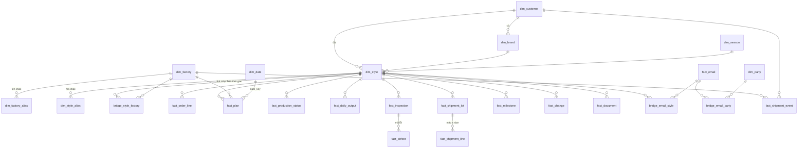

# Mô hình dữ liệu liên kết (D-01)

Lớp `dim` / `fact` / `bridge` dựng trên `core` (bản hiện hành của từng nguồn) trong `sql/30_model.sql`, dùng trực tiếp cho
dashboard quản lý. Bảng `core` / `mart` cũ giữ nguyên tên và nội dung (check golden không đổi). Dữ liệu giả định (D-04) nằm
riêng trong schema `sim`, cùng khoá dim, `is_synthetic = true`; mọi fact ở đây là dữ liệu thật (`is_synthetic = false`).

Số dòng: đo ngày 23/10/2026 trên `dw/build/kops.duckdb` (dữ liệu thật). Lệnh xem lại: `duckdb build/kops.duckdb "SUMMARIZE dim.style"`.

## ERD

## Dimension

| Bảng | Khoá thay thế | Khoá tự nhiên | Nguồn | Dòng |
|---|---|---|---|---|
| `dim.customer` | customer_key | customer (CHALLENGER, DHG, JBEE, KOFA, DKM) | ORDER RECAP, kế hoạch, `config.CUSTOMER_NAMES` | 5 |
| `dim.brand` | brand_key | customer + brand | ORDER RECAP, kế hoạch, PDF DHG | 9 |
| `dim.season` | season_key | season (`26FW`) + năm, nửa mùa, ngày bắt đầu/kết thúc theo mùa bán (giả định ASM-SEASON-01) | mọi nguồn có mùa | 2 |
| `dim.date` | date_key (`yyyymmdd`) | ngày; tuần (thứ hai), tháng, Chủ nhật | sinh 2024–2028 | 1.827 |
| `dim.factory` | factory_key | factory_code chuẩn | `config.FACTORY_ALIASES` + mã trong dữ liệu + bí danh chờ xác nhận | 25 |
| `dim.factory_alias` | — | alias_key (viết hoa, bỏ dấu) | CONFIRMED (config) 37; chờ Q09: HD2 / HAGACO HD2 → HAGACO (MEDIUM), FG BG → FG BAC GIANG, CHI ANH (LOW) | 41 |
| `dim.style` | style_key | `customer|season|style_no` | **master = mọi phiên bản ORDER RECAP** (style bị bỏ ở bản mới vẫn là style); thuộc tính lấy từ bản hiện hành | 410 |
| `dim.style_alias` | — | alias_code + season → style_key | xem "Quy tắc alias" | 603 |
| `dim.party` | party_key | địa chỉ email | KLMAS theo `KOPS_KLMAS_DOMAINS`; file local `dw/party_map.local.txt` (không commit) cho BUYER / FACTORY / FORWARDER; Gmail, Naver… = INDIVIDUAL; còn lại EXTERNAL | 132 |

Khoá thay thế là số thứ tự theo khoá tự nhiên: ổn định khi dữ liệu không đổi, dựng lại mỗi lần build. Liên kết bền vững
giữa các lần build dùng khoá tự nhiên.

## Fact

Mọi fact có `customer_key, season_key, style_key, factory_key, date_key, source_file_id, is_synthetic` (fact không gắn style
thì `style_key` rỗng) và `link_issue` (lý do không nối được style).

| Bảng | Grain | Nguồn | Ngày (`date_key`) | Dòng |
|---|---|---|---|---|
| `fact.order_line` | style × màu (CHALLENGER) / style × dòng đơn (khách khác), bản RECAP hiện hành | `core.order_color`, `core.order_line_ext` | ETD VN | 748 |
| `fact.plan` | style × nhà máy × bản kế hoạch | `core.production_plan` | ngày xuất xưởng dự kiến | 246 |
| `fact.production_status` | style × bản PRODUCTION AND SHIPPING STATUS | `core.production_snapshot` | as of | 110 |
| `fact.daily_output` | style × nhà máy × ngày báo cáo: SL ra chuyền trong ngày (TODAY, hoặc chênh lệch TTL), luỹ kế, vào chuyền, cắt | `core.daily_output_series` (báo cáo sản xuất ngày, D-02); dòng style mùa cũ còn sót trong sheet (LEV-24xxx) không vào core | ngày báo cáo | 3.048 |
| `fact.inspection` | một kết quả kiểm: KLMAS = style × món × màu × ngày (SL đạt); THIRD_PARTY = một lần kiểm (SL kiểm, đạt, lỗi, PASS/REJECT) | `core.inspection_passed`, `core.qc_inspection` | ngày kiểm | 110 + 3.124 |
| `fact.inspection_day` | nhà máy × ngày (bảng kiểm KLMAS dòng A / C / D / F: đạt, đã kiểm, điểm lỗi, số kiểm viên; **không có tên**) | `core.inspection_day` | ngày kiểm | 45 |
| `fact.defect` | lần kiểm bên thứ ba × mã lỗi (minor, major) | `core.qc_defect` + bảng mã A–G | ngày kiểm | 9.632 |
| `fact.shipment_line` | lô × style × màu × size (mục SHIPMENT, SAMPLE) | `core.shipment_detail` | ETD lô | 1.878 |
| `fact.shipment_lot` | lô × style | gom `fact.shipment_line` | ETD lô | 186 |
| `fact.milestone` | style × mốc × nguồn (thư / tài liệu) | `core.style_milestone` (luật trên tiêu đề / tên file), `extractor` = rule | ngày gửi thư / ngày trong tên file | 292 |
| `fact.shipment_event` | lô hàng theo booking (hoặc nhà máy + ETD) | `core.shipment_event` | ETD mới | 31 |
| `fact.change` | một thay đổi của một style | ghi chú SL / nhà máy trong RECAP, khác biệt giữa các bản RECAP, đề xuất từ email (`PENDING_REVIEW`) | ngày thay đổi | 636 |
| `fact.email` | một thư sau gộp trùng (`msg_key`) | `core.email` | ngày gửi | 363 |
| `fact.document` | một tài liệu kỹ thuật (chỉ tên) | `core.document` | ngày trong tên | 226 |

## Bridge

| Bảng | Nội dung | Dòng |
|---|---|---|
| `bridge.style_factory` | Nhà máy của style theo thời gian (SCD2: `valid_from`, `valid_to`, `is_current`) từ ghi chú `MOVED FACT` trong RECAP + nhà máy ở bản hiện hành | 486 |
| `bridge.email_style` | Thư ↔ style (mã trong tiêu đề + nội dung, khớp bằng token N-07) | 607 |
| `bridge.email_party` | Thư ↔ địa chỉ (FROM / TO / CC) | 4.542 |

**Mart dựng trên mô hình:** `mart.style_funnel` (E-03, `sql/34_funnel.sql`) — grain style × màu × size (`level = 'SIZE'`) và style × màu (`level = 'COLOR'`): đặt → cắt → may → đạt kiểm → xuất, cờ `CUT_SHORT` / `OUTPUT_GT_CUT` / `SHIP_GT_ORDER`; chỉ dữ liệu thật. Định nghĩa trong `metrics.md`.

## Quy tắc alias style (không fuzzy match)

Một mã trong fact nối được style khi nó có trong `dim.style_alias` với đúng mùa (hoặc chỉ một style nếu fact không có mùa).

| kind | Nguồn | Ví dụ | Tin cậy |
|---|---|---|---|
| STYLE | mã style trong RECAP | `CHF3WJK6701`, `BI7139UE1` | HIGH |
| FILE_NO | cột FILE NO trong RECAP | `LBV-27002` → `BI7139UE1` | HIGH |
| FILE_NO_HEAD | phần đầu của file no có hậu tố | `LXV-25005-5` → `LXV-25005` | MEDIUM |
| ALIAS | mã ghi kèm `(=…)` trong RECAP | `32MK0000` → `32YA6F00` | HIGH |
| TYPO | `config.STYLE_ALIASES` (Q05, chưa xác nhận) | `CHFWWT6817` → `CHF4WWT6817` | MEDIUM |
| PLAN_FILE_NO | dòng kế hoạch có mã style đã có trong master | file no ↔ style | HIGH |
| BUYER_PDF | dòng PDF "오더 현황표" có mã style đã có trong master | `LEV-27001` ↔ `357121WM1` | HIGH |

- Một mã trỏ tới hai style trong cùng mùa thì không dùng (`ambiguous`, 9 mã), dòng fact ghi `AMBIGUOUS_CODE`.
- Lỗi gõ khác (CHE→CHF, thiếu số) chỉ thêm vào `config.STYLE_ALIASES` khi có bằng chứng; tới 23/10 chưa thấy trong fact.
- Tên thư mục `STYLES/…` của dự án không dùng làm alias (GUIDELINES §2).

## Kiểm tra liên kết

- `etl.link_orphan`: mỗi dòng fact có mã style mà không nối được, kèm lý do: `NOT_IN_ORDER_RECAP`, `AMBIGUOUS_CODE`,
  `NO_ORDER_RECAP_FOR_SEASON` (không tính vào tỉ lệ).
- `mart.link_rate`: tỉ lệ theo khách × mùa. Check: CHALLENGER 26FW ≥ 98% (đạt 100%); khách khác, tính chung mọi mùa, ≥ 90%
  (DHG 90,4%, DKM 99,1%, JBEE / KOFA 100%).
- Orphan chính (23/10): 38 tài liệu BEANPOLE KIDS 26FW (LBV-26002, LBV-26017, BI6838U03…) vì chưa nhận ORDER RECAP BPK 26FW;
  `32YA7B25` (DKM 27SS) trỏ tới 2 style; 1 phiếu kiểm mẫu FNJWD8411 không có khách.
