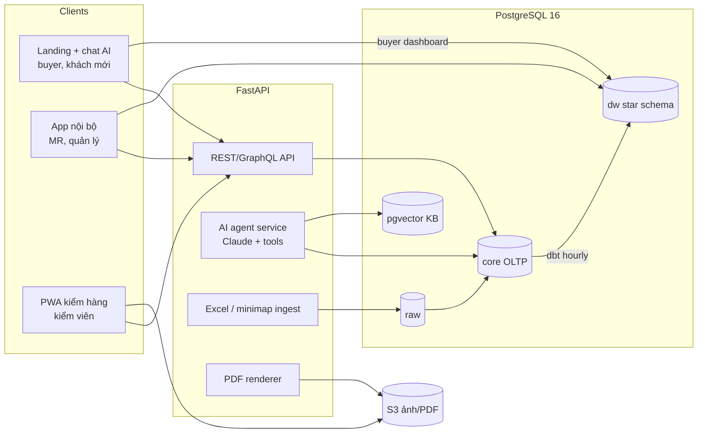

# KOPS — Đề xuất prototype & kiến trúc

Tài liệu đi kèm `KOPS_prototype.html` (mở trực tiếp bằng trình duyệt, không cần server) và `dw_schema.sql`.
Căn cứ: phân tích 6 file trong `raw-docs` (thư mục `analys-docs`) và biên bản họp KOPS lần 1 ngày 15/10/2026.
Câu hỏi nghiệp vụ trong `open_questions.md` để nguyên; các câu hỏi kỹ thuật được chốt như dưới đây.

## 1. Ba phần của prototype

| Phần | Người dùng | Màn hình trong prototype | Dữ liệu |
|---|---|---|---|
| ① Trang công ty + trợ lý AI + tra cứu đơn | Buyer, khách tiềm năng | Landing VI/KO; thẻ hangtag tra cứu theo mã style hoặc số đơn (`26FW-F9`); dashboard tiến độ 8 bước; chat AI có công cụ tra đơn; form yêu cầu tư vấn | Thật: 110 style 26FW, 143 style 27SS, lô xuất theo màu |
| ② Kho dữ liệu sản xuất | MR, quản lý | Tổng quan mùa; lưu trữ style; đối tác & tỷ lệ return; lịch sử đổi nhà máy; tiến độ & cảnh báo; mô hình DW | Thật: tiến độ, lô xuất, 21 style đổi nhà máy, nhà cung cấp vải. Mô phỏng: 3 mùa cũ, return/claim |
| ③ Tư vấn & QC | MR, kiểm viên, QA nhà máy | Kanban tư vấn có AI gợi ý nhà máy; hộp thư buyer có AI soạn trả lời và trích thay đổi; AI phân công kiểm viên; form kiểm trên điện thoại → PDF; phân tích lỗi | Thật: style chờ kiểm, dữ liệu trả lời buyer. Mô phỏng: kiểm viên, thương hiệu ngoài, lỗi |

Ô có nhãn **mô phỏng** là chỗ chưa có file nguồn; khi KLMAS gửi báo cáo kiểm, file mùa cũ, danh sách kiểm viên thì thay bằng dữ liệu thật.

## 2. Đối chiếu 14 yêu cầu trong biên bản họp

| # | Yêu cầu | Trong prototype | Giai đoạn đề xuất |
|---|---|---|---|
| 1 | Upload minimap/order list → master style, AI nhận dạng | Bước "Phân tích minimap" trong luồng tư vấn (mô tả); parser thật đã chạy trên ORDER RECAP | MVP-1 |
| 2 | AI đọc email/Kakao về thay đổi → cập nhật có lịch sử | Hộp thư buyer: email giảm 20% số lượng → 3 thay đổi có cấu trúc → "Áp dụng" ghi lịch sử | MVP-2 |
| 3 | ID theo người, log ai sửa gì; buyer đăng nhập | Ghi người duyệt + nguồn email khi áp dụng thay đổi; ghi chú đăng nhập buyer ở thẻ tra cứu | MVP-1 |
| 4 | Gom style theo nhà cung cấp/tên vải | Tìm kiếm trong "Lưu trữ style" theo tên vải; bảng nhà cung cấp | MVP-1 |
| 5 | Lịch sử đổi màu/số lượng có cấu trúc | `order_qty_change` + hộp thư; lịch sử đổi nhà máy (SCD2) | MVP-1 |
| 6 | Một nguồn dữ liệu cho mọi báo cáo, xuất Excel | Mọi tổng tính từ chi tiết (sửa lỗi tổng 106.681 → 62.357) | MVP-1 |
| 7 | Bấm số lượng xuất → chi tiết màu × size | Dashboard tra cứu: lô xuất + theo màu; DW có grain màu × size | MVP-1 |
| 8 | Cảnh báo trễ so với lịch ngược từ RDD, dưới kế hoạch | "Tiến độ & cảnh báo": dự kiến sẵn sàng = còn lại ÷ SL ngày (bỏ CN) + 5 ngày | MVP-1 |
| 9 | Phát hiện sớm thiếu vật tư | Cảnh báo thiếu TOP sample; vật tư dùng bảng FAB (định mức × SL) | MVP-2 |
| 10 | Lịch tàu, tự gửi email booking | Chưa làm (cần API hãng tàu do brand chỉ định) | Sau MVP |
| 11 | Kiểm viên nhập lỗi + ảnh trên mobile → PDF; mẫu theo brand; tách đơn KLMAS/ngoài | Form điện thoại: AQL tự tính, 12 mã lỗi, 9 ô ảnh, tài liệu theo brand, PDF | MVP-1 (QC) |
| 12 | AI phân công kiểm viên ngày mai | "Lịch & phân công": chuyên trách nhà máy, khu vực, mặt hàng, ghép chuyến | MVP-2 |
| 13 | Dashboard trực quan cho buyer | Thẻ hangtag → dashboard 8 bước | MVP-1 |
| 14 | AI gợi ý trả lời buyer, MR duyệt; agent theo vai trò | Hộp thư: bản nháp tiếng Hàn từ dữ liệu thật, nút "Duyệt và gửi" | MVP-2 |

## 3. Lựa chọn kỹ thuật (đã chốt cho phần tech)

| Hạng mục | Chọn | Lý do |
|---|---|---|
| Frontend | **Next.js 15 (React, TypeScript)**, một repo: landing (SSR, i18n vi/ko/en) + app nội bộ | SEO cho landing; dùng chung component với app; đội ASTRA quen React |
| Mobile kiểm hàng | **PWA** trong cùng app (camera, offline queue bằng IndexedDB, đồng bộ khi có mạng) | Nhà máy hay mất sóng; không phải phát hành app store; 70–100 báo cáo/ngày |
| Backend API | **FastAPI (Python 3.12)** | Parser Excel/xlsb, sinh PDF, gọi LLM đều mạnh nhất trong Python; parser prototype đã viết bằng Python |
| CSDL vận hành | **PostgreSQL 16**, schema `core` (đã thiết kế ở `analys-docs/schema.sql`) | Ràng buộc mạnh, JSONB, tiếng Việt và tiếng Hàn |
| Kho dữ liệu | **Cùng cụm PostgreSQL, schema `dw`** (star schema, `dw_schema.sql`), dựng bằng **dbt**, chạy mỗi giờ | ~300 style/mùa, vài chục nghìn dòng: chưa cần BigQuery/ClickHouse. Khi kiểm hàng bên thứ ba (khoảng 50 đối tác) làm dữ liệu tăng mạnh, chuyển `dw` sang ClickHouse mà không đổi mô hình |
| AI | **Claude API**: Sonnet cho chat và soạn email (tool use), Haiku cho phân loại tin nhắn; **pgvector** cho kho tri thức (hồ sơ năng lực, biên bản, Q&A từ email cũ) | Tool calling đã thể hiện trong prototype: `get_order_status`, `search_kb`, `create_ticket`, `propose_change` |
| Nhận dạng minimap/order list | Claude (vision + structured output) → bảng chờ duyệt; MR xác nhận từng dòng không chắc | Minimap mỗi brand một định dạng, có loại là ảnh |
| File & ảnh | S3-compatible (AWS S3 Singapore hoặc Cloudflare R2), ảnh nén phía client | Ảnh lỗi là phần lớn dung lượng |
| PDF báo cáo kiểm | HTML template theo brand → PDF bằng Playwright (server) | Giữ nguyên khung mẫu báo cáo, chỉ đổi hiển thị (đã thống nhất trong họp) |
| Đăng nhập & phân quyền | Auth.js / Keycloak; vai trò: MR, QA nhà máy, kiểm viên, buyer, admin; row-level security theo brand cho buyer | Buyer chỉ thấy đơn của mình |
| Thông báo | Zalo OA (nội bộ VN), email; KakaoTalk qua Business API ở giai đoạn sau | Kênh đang dùng thực tế |
| Hạ tầng | AWS ap-southeast-1, Docker, 1 VM app + RDS Postgres ở MVP | Gần Việt Nam và Hàn Quốc, chi phí thấp |
| Nhập liệu giai đoạn đầu | Vẫn nhận Excel: pipeline `raw → core` (`analys-docs/etl_pipeline.md`), chạy song song 2–4 tuần | Không bắt KLMAS bỏ Excel ngay |

## 4. Các quy tắc nghiệp vụ đã cài trong prototype (cần KLMAS xác nhận)

- `RDD = ETD VN + 12 ngày` (tàu 7 + nhập kho 5).
- Ngày sẵn sàng xuất = SL còn lại ÷ SL ngày, bỏ Chủ nhật, cộng 5 ngày hoàn thiện và kiểm. Khi nhà máy chưa báo SL ngày, dùng 45 pcs/ngày (ví dụ trong biên bản).
- "Xuất đúng hạn" = lô đầu tiên có ETD không muộn hơn ETD style quá 7 ngày. Kết quả 26FW: 79% style.
- AQL: ISO 2859-1 mức kiểm II, Major 2.5, Minor 4.0, Critical 0 (bảng rút gọn, chưa xử lý mũi tên với lô nhỏ).
- Tỷ lệ return = (SL trả nhà máy tái chế + SL buyer claim) ÷ SL đã kiểm.
- Phân công kiểm: tối đa 3 lô/người/ngày (2 nếu khác nhà máy), ưu tiên kiểm viên chuyên trách nhà máy, rồi cùng khu vực, rồi đúng mặt hàng. Khu vực nhà máy trong prototype là giả định.

## 5. Bước tiếp theo đề xuất

1. Demo prototype cho KLMAS (TGĐ Kim, chị Lee Min Ji) và ghi nhận góp ý theo từng màn hình. Mục tiêu theo biên bản: prototype trước, rồi mới bàn sâu với dev.
2. Xin dữ liệu để thay phần mô phỏng: 1–2 mùa đã kết thúc, 1 tuần báo cáo kiểm (Excel + ảnh), danh sách kiểm viên và khu vực nhà máy, 20–30 email/Kakao mẫu với buyer.
3. Chốt phạm vi MVP-1: upload ORDER RECAP/minimap → master style → màn hình ORDER RECAP, tra cứu buyer, cảnh báo tiến độ, form kiểm hàng PWA.
4. Dựng `core` + `dw` thật từ hai file SQL; viết parser cho 4 template Excel (đã có prototype parser).
